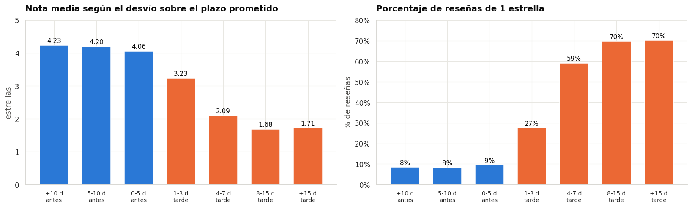
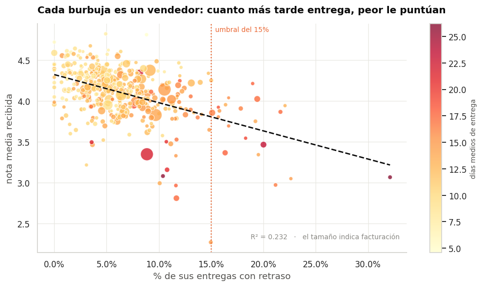
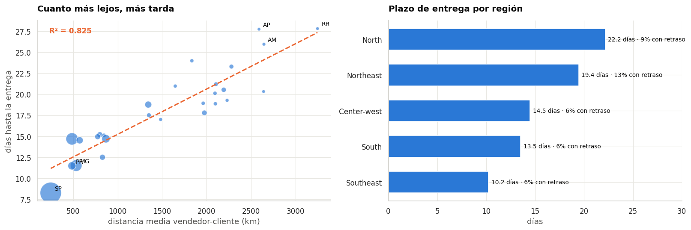
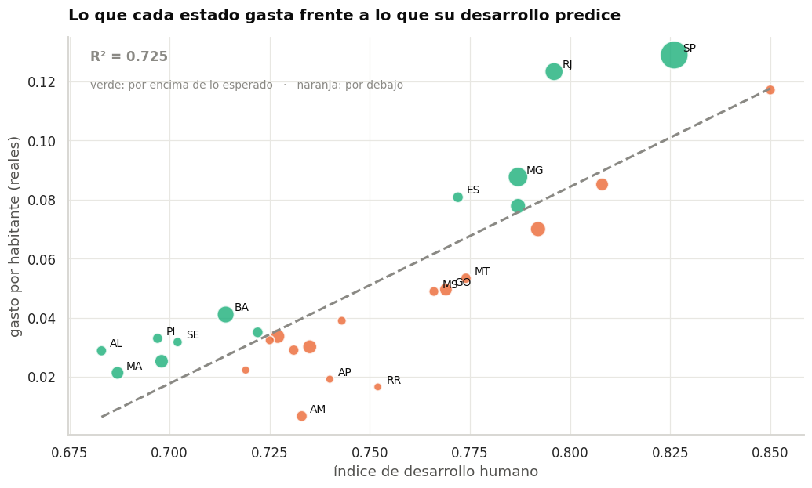
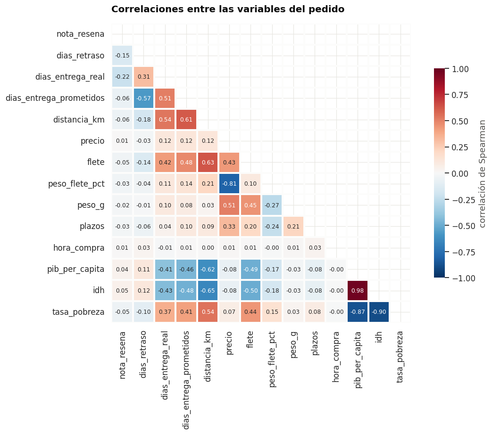

# ¿Qué le cuesta a Olist una reseña de una estrella?

Análisis exploratorio, estudio estadístico y dashboard sobre **112.650 líneas de pedido** del marketplace brasileño Olist, cruzadas con el contexto socioeconómico de los 27 estados de Brasil.

**Proyecto Final del Bootcamp de Data & Analytics — Álvaro Velarde**

---

## El hallazgo

> Solo el **6,5%** de los pedidos llega tarde.
> Pero el **54,5%** de esos acaba en una reseña de una estrella, frente al 8,4% de los que llegan a tiempo.
> Y **veinte vendedores**, que mueven el 2,1% de la facturación, concentran el problema.



La nota no cae de golpe: baja de forma escalonada conforme aumenta el retraso, de 4,23 a 1,68 estrellas. Esa gradualidad es lo que convierte una correlación en un argumento.

---

## Índice

1. [Qué se ha hecho](#qué-se-ha-hecho)
2. [Cómo está organizado](#cómo-está-organizado)
3. [Cómo reproducirlo](#cómo-reproducirlo)
4. [Los datos](#los-datos)
5. [Cómo está montado](#cómo-está-montado)
6. [Cómo se resolvió cada problema](#cómo-se-resolvió-cada-problema)
7. [Informe del análisis](#informe-del-análisis)
8. [Conclusiones y recomendaciones](#conclusiones-y-recomendaciones)
9. [Limitaciones](#limitaciones)

---

## Qué se ha hecho

Un recorrido completo de principio a fin: desde dos conjuntos de datos en bruto y de fuentes distintas hasta un dashboard operativo, pasando por la limpieza, el análisis estadístico y una base de datos relacional.

```
2 fuentes en bruto  →  Python + pandas  →  PostgreSQL  →  Power BI
  (10 tablas)          limpieza, unión,    modelo en      dashboard
                       EDA, estadística     estrella       operativo
```

La pregunta de negocio que lo guía todo tiene dos hilos:

- **Operativo** — ¿qué destruye la reputación de la plataforma y quién es responsable?
- **Comercial** — ¿en qué estados se vende por debajo de lo que su población y su desarrollo permitirían?

## Cómo está organizado

```
├── README.md
├── requisitos.txt
├── data/
│   ├── raw/
│   │   ├── olist_brazilian_ecommerce.zip     Fuente 1: 9 tablas de Olist
│   │   └── brasil_estados_ibge.zip           Fuente 2: datos de los estados
│   └── processed/
│       ├── ventas_olist_limpio.csv.gz        Tabla analítica: 112.650 × 65
│       ├── registro_limpieza.csv             Las 14 decisiones de limpieza
│       ├── modelo_estrella/                  Hechos y dimensiones para la base
│       └── vistas/                           Las 6 vistas en CSV, para Power BI
├── notebooks/
│   ├── 01_limpieza_y_union.ipynb
│   └── 02_analisis_y_estadistica.ipynb
├── src/
│   ├── limpieza.py                           Funciones de transformación
│   └── estadistica.py                        Contrastes e intervalos
├── sql/
│   ├── 01_esquema.sql                        Modelo en estrella
│   ├── 02_cargar_datos.py                    Carga en PostgreSQL
│   ├── 03_vistas_analiticas.sql              6 vistas para el dashboard
│   └── 04_materializar_vistas.py             Las mismas 6 vistas, a CSV
├── powerbi/
│   ├── GUIA_DASHBOARD.md                     Carga, modelo, DAX y guion visual
│   ├── tema_olist.json                       Tema de Power BI: paleta y estilo
│   ├── dashboard_olist.pbix                  El informe
│   ├── dashboard_olist.pdf                   El informe, para verlo sin Power BI
│   └── capturas/                             Las tres páginas en imagen
└── img/                                      Gráficos del análisis
```

## Cómo reproducirlo

**Requisitos**: Python 3.9 o superior, PostgreSQL 14 o superior y Power BI Desktop.

```bash
pip install -r requisitos.txt
```

**1. Limpieza y unión.** Abrir `notebooks/01_limpieza_y_union.ipynb` y ejecutarlo entero. Lee los dos ZIP en bruto y genera la tabla analítica y el modelo en estrella en `data/processed/`.

**2. Análisis.** Ejecutar `notebooks/02_analisis_y_estadistica.ipynb`. Produce el estudio estadístico y los gráficos. Necesita que el paso anterior se haya ejecutado.

**3. Vistas analíticas.** Las seis vistas que alimentan el dashboard existen por duplicado, a propósito:

```bash
python sql/04_materializar_vistas.py
```

deja los seis CSV en `data/processed/vistas/`, que es de donde los lee Power BI. Y las mismas seis, con idéntica lógica, viven como vistas de PostgreSQL:

```bash
createdb olist
psql -d olist -f sql/01_esquema.sql
python sql/02_cargar_datos.py
psql -d olist -f sql/03_vistas_analiticas.sql
```

La versión en base de datos es la correcta conceptualmente: la lógica de negocio en un único sitio, consultable por cualquier herramienta. La versión en CSV existe por una razón práctica: permite abrir el informe sin tener que instalar y cargar un servidor, y así el proyecto se puede revisar clonando el repositorio y nada más.

**4. Dashboard.** Seguir `powerbi/GUIA_DASHBOARD.md`, que detalla la carga con Power Query, las relaciones del modelo, las treinta medidas DAX y la posición exacta de cada visual de las tres páginas. El anexo de esa guía explica cómo apuntar el mismo modelo contra PostgreSQL si se prefiere esa ruta.

## Los datos

| | Fuente 1 | Fuente 2 |
|---|---|---|
| **Origen** | Olist, marketplace brasileño | Instituto Brasileño de Geografía y Estadística |
| **Contenido** | Pedidos, artículos, pagos, reseñas, clientes, vendedores, productos, geolocalización | Población, PIB, pobreza, densidad e índice de desarrollo humano |
| **Tablas** | 9 | 2 |
| **Filas** | 1.550.000 | 54 |
| **Periodo** | Septiembre 2016 – octubre 2018 | Censo más reciente |

Son dos organizaciones distintas y sin relación entre sí: una empresa privada y un organismo público. Se unen por el código de dos letras del estado.

**Tabla analítica resultante: 112.650 filas × 65 columnas.** El grano es una línea de pedido, no un pedido: un pedido con tres artículos son tres filas, porque cada artículo puede venir de un vendedor distinto con su propio precio y su propio flete.

| | Mínimo exigido | Este proyecto |
|---|---:|---:|
| Filas | 50.000 | 112.650 |
| Columnas | 20 | 65 |
| Fuentes distintas | 2 | 2 |

## Cómo está montado

El proyecto sigue un flujo donde cada pieza deja el trabajo hecho para la siguiente.

**El notebook 01 es el único que toca las fuentes originales.** Lee los dos ZIP tal y como se descargaron —sin descomprimirlos, para que el repositorio guarde las fuentes exactamente como llegaron— y escribe la tabla limpia en `data/processed/`. A partir de ahí los datos en bruto no se vuelven a abrir.

**El notebook 02 parte de esa tabla** y solo analiza. La separación tiene una ventaja práctica: probar una idea nueva en el análisis cuesta segundos en lugar de volver a procesar 1,5 millones de filas.

**`src/` guarda las funciones compartidas.** `limpieza.py` tiene la consolidación de coordenadas, la fórmula de Haversine y la clase que lleva el registro de decisiones; `estadistica.py` tiene los contrastes, los intervalos de confianza y el tamaño del efecto. Estaban repetidas en los dos notebooks y cada corrección había que hacerla dos veces.

**PostgreSQL recibe el modelo en estrella**, no la tabla plana. Una tabla de hechos con las medidas y cinco dimensiones con los atributos. En una tabla plana, "Rio de Janeiro" aparecería repetido 14.000 veces; en el modelo está una sola vez y los hechos guardan solo el código. Sobre ese modelo hay seis vistas que resuelven los cálculos recurrentes en la base de datos, de forma que la lógica de negocio vive en un único sitio y no duplicada en cada informe.

**Power BI se conecta a esas vistas**, no a ficheros sueltos.

## Cómo se resolvió cada problema

Los catorce pasos están documentados en `data/processed/registro_limpieza.csv` con sus filas afectadas y su justificación. Estos son los que tuvieron más miga.

**Un millón de filas de geolocalización para 19.015 códigos postales.** La tabla trae una fila por dirección registrada, así que un mismo código postal aparece cientos de veces con coordenadas ligeramente distintas. Unirla en crudo habría multiplicado la tabla final por cientos. Se agregó a una coordenada por código postal usando la **mediana y no la media**, porque 42 puntos caen fuera de Brasil —alguno en pleno océano— y la media los habría arrastrado.

**Hasta 29 pagos y 21 artículos en un mismo pedido.** Tres tablas tienen grano más fino que el pedido. Los pagos se agregaron antes de unir —importe total, plazos máximos y método principal, entendido como el que más dinero aporta— y de las reseñas duplicadas se conservó la más reciente, que es la valoración definitiva una vez cerrada la incidencia. La comprobación de que funcionó es que **las filas no se movieron de 112.650 en ningún paso de la unión**.

**Cinco marcas de tiempo sueltas y ninguna medida de plazo.** De ahí salen los días de entrega reales y prometidos, el retraso frente a lo prometido, los días hasta la recogida y las horas hasta la aprobación del pago. La clave fue medir el **retraso frente a lo prometido y no el plazo absoluto**: veinte días esperados no molestan, cinco días sobre tres prometidos sí.

**Ninguna forma de saber cuánto viaja un pedido.** Se calculó la distancia entre vendedor y cliente con la fórmula de Haversine. Restar coordenadas no vale, porque un grado de longitud mide distinto según la latitud. Está vectorizada con numpy para resolver las 112.650 distancias de golpe.

**Nulos que no son errores.** Las fechas de entrega faltan en los pedidos que no llegaron a entregarse; la nota, en los que nadie valoró. Rellenarlos inventaría entregas y opiniones. **No se imputó ningún valor**: pandas ya excluye los nulos de los cálculos, y forzar una media distorsionaría justo los análisis que vienen después.

**No se eliminó ninguna fila.** Las 112.650 líneas originales se conservan íntegras.

## Informe del análisis

### El negocio en cifras

| | |
|---|---|
| Facturación | 15.843.553 R$ (13,6 M de producto + 2,3 M de flete) |
| Pedidos | 98.666 |
| Clientes | 95.420 |
| Vendedores | 3.095 |
| Nota media | 4,03 / 5 |
| Plazo medio de entrega | 12,0 días |
| Plazo medio prometido | 23,2 días |
| Entregas con retraso | 6,5% |

Olist promete el doble de lo que tarda. No es un descuido: esa holgura es lo que mantiene los incumplimientos bajos, y conviene tenerlo presente antes de proponer plazos más agresivos.

### El retraso destruye la reputación

Contrastando la nota de los pedidos puntuales contra la de los retrasados:

| | A tiempo | Con retraso |
|---|---:|---:|
| Pedidos | 102.279 | 7.083 |
| Nota media | **4,21** | **2,26** |
| Intervalo de confianza 95% | 4,20 – 4,22 | 2,22 – 2,29 |
| Reseñas de 1 estrella | 8,4% | **54,5%** |
| Intervalo de confianza 95% | 8,3% – 8,6% | 53,3% – 55,6% |

Se aplicaron dos contrastes con supuestos distintos —**t de Welch** y **Mann-Whitney**— y ambos rechazan la hipótesis nula con p < 0,001. Pero con 109.000 observaciones cualquier diferencia sale significativa, así que lo relevante es el tamaño del efecto: la **d de Cohen es 1,55**, muy por encima del 0,8 que marca un efecto grande. La prueba chi-cuadrado sobre la tabla de contingencia da una **V de Cramér de 0,376**, una asociación moderada-fuerte.

Y la relación es **gradual**: 4,23 → 4,20 → 4,06 → 3,23 → 2,09 → 1,68. Una variable que solo acompañara al problema real no produciría un escalón tan ordenado.

### El problema tiene nombre y apellidos



De los 425 vendedores con 50 pedidos o más, que concentran el 69% de la facturación, **veinte superan el 15% de entregas tardías**. Manejan 322.000 reales, el 2,1% del total, y su nota media es un punto entero inferior al resto. La correlación entre la tasa de retraso de un vendedor y su nota media es de **−0,48**.

Auditar veinte proveedores es trabajo de una tarde. El coste de no hacerlo es la reputación de la plataforma entera.

### La geografía manda sobre la logística



La distancia media explica el **83%** de la variación del plazo de entrega entre estados. En buena medida no es corregible: Brasil es enorme y los vendedores están donde están, el 71% de las ventas salen de São Paulo.

Pero la comparación entre regiones enseña lo que sí lo es. El Nordeste tarda 19,4 días y tiene un **13% de entregas tardías**, más del doble que el Sudeste. El Norte paga un flete del **50% sobre el precio**, frente al 29% del Sudeste. Vender dentro del mismo estado baja la tasa de retraso del 8,2% al 4,4%.

Un matiz de rigor: enviar fuera del estado casi duplica la tasa de retraso, pero su efecto directo sobre la nota es de 0,05 estrellas, estadísticamente significativo y en la práctica irrelevante. Es el caso de manual de por qué hay que mirar el tamaño del efecto y no solo el p-valor.

### Dónde queda mercado por captar



Aquí entra la segunda fuente. El índice de desarrollo humano del estado explica el **72,5%** de la variación en gasto por habitante, una relación con sentido: comprar por internet exige renta disponible, conexión y confianza en el pago electrónico.

Lo interesante son los puntos por debajo de la recta, que gastan menos de lo que su desarrollo haría esperar:

| Estado | Gasto/hab real | Esperado | Días de entrega |
|---|---:|---:|---:|
| Amazonas | 0,007 | 0,040 | 26,0 |
| Roraima | 0,017 | 0,052 | 27,8 |
| Amapá | 0,019 | 0,044 | 27,8 |
| Goiás | 0,050 | 0,064 | 14,9 |
| Mato Grosso | 0,053 | 0,067 | 17,5 |

**Y aquí los dos hilos se encuentran.** Los estados con más recorrido comercial son exactamente los que tardan 26-28 días en recibir un pedido. No es que no quieran comprar: es que comprar ahí es una mala experiencia.

### Lo que no explica nada



Ninguna variable de producto o precio se relaciona con la valoración. Ni el precio, ni el peso, ni el número de plazos, ni la hora de compra. **El cliente de Olist no puntúa lo que compra: puntúa cuándo le llega.**

La única excepción parcial son las categorías de mobiliario —escritorios de oficina (3,49), salón (3,90), decoración (3,90)—, que son también las más pesadas, con hasta 11 kg de media. Ahí el problema es de manipulación y embalaje, no de producto.

## Conclusiones y recomendaciones

**Auditar a los veinte vendedores críticos.** Superan el 15% de entregas tardías, mueven solo el 2,1% de los ingresos y arrastran la nota de la plataforma. Plan de mejora con plazo y salida del catálogo si no corrigen.

**Captar vendedores locales en el Norte y el Nordeste.** Vender dentro del mismo estado casi reduce a la mitad la tasa de retraso. Es la única medida que ataca a la vez el problema logístico y el comercial, porque son las regiones con más mercado sin explotar.

**No recortar los plazos prometidos.** La holgura de once días entre lo prometido y lo real es lo que mantiene los incumplimientos en el 6,5%. Prometer menos para parecer más rápido dispararía los retrasos, que es lo que de verdad destruye la nota. Si acaso, ampliarla en las rutas hacia el Norte.

**Revisar el embalaje del mobiliario**, donde el problema no es el producto sino su tamaño y su manipulación.

## Limitaciones

- El periodo va de septiembre de 2016 a octubre de 2018, y 2016 solo tiene 329 pedidos: no es representativo y queda fuera de las conclusiones.
- La relación entre retraso y valoración es de **asociación, no de causalidad demostrada**. El gradiente escalonado y la ausencia de otras variables explicativas la respaldan con fuerza, pero no equivalen a un experimento controlado.
- Los datos de población y desarrollo son posteriores al periodo de ventas, así que la penetración es una aproximación.
- Un 0,3% de las filas no tiene coordenadas porque su código postal no aparece en la tabla de geolocalización, y para esas no hay distancia calculada.

## Herramientas

Python · pandas · NumPy · SciPy · matplotlib · seaborn · PostgreSQL · SQLAlchemy · Power BI · Visual Studio Code
